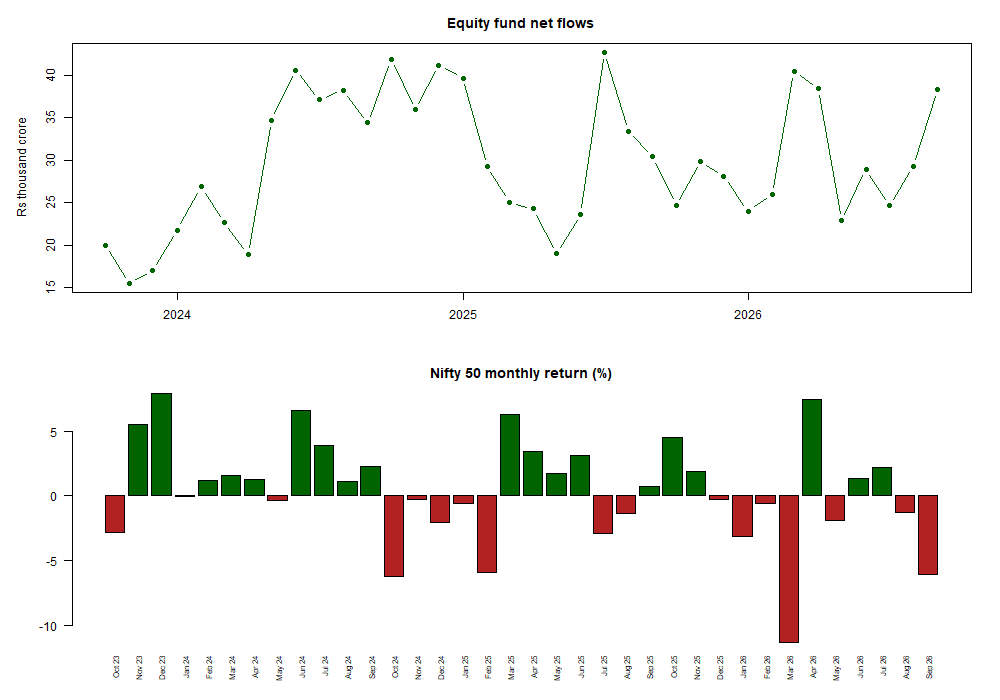

# Mutual Funds Flows Dashboard

An end-to-end analysis of **Indian mutual fund flows**, built using **R**. It studies how investor money moves across fund categories (equity, debt, hybrid, gold ETFs, index funds and others), and whether those flows react to the stock market.

Everything is written in **R**: downloading and scraping the data, cleaning it, and the statistical analysis. The clean results are then visualised in Power BI and Tableau.



## Data

| Source | What | How it is collected |
|---|---|---|
| [AMFI](https://www.amfiindia.com/) monthly reports | Inflows, outflows, net flows and AUM by scheme category | 36 Excel files downloaded in a loop |
| AMFI [mutual-fund page](https://www.amfiindia.com/mutual-fund) | Monthly SIP contributions | HTML table scraped with `xml2` |
| Yahoo Finance (`^NSEI`) | Nifty 50 monthly closing prices | JSON read with `jsonlite` |

- **Period:** October 2023 to September 2026 (36 months).
- **Units:** all amounts are in Rs crore (1 crore = 10 million rupees).
- **About AMFI:** AMFI is the industry body for Indian mutual funds; SEBI is the regulator.

## Research questions and findings

| Question | Method | Finding |
|---|---|---|
| Where is the money going? | Totals, shares, t-tests | **Equity** took in money in **all 36 months** (average Rs 29,700 cr/month) and received **52%** of all net inflows. Hybrid received 20% and ETFs other than gold 12%. |
| Do investors chase returns? | `lm(equity_flow ~ nifty_return + lag)` | **No, the opposite.** A month with a 1 percentage point higher Nifty return comes with about **Rs 733 cr *lower*** equity net flows (p = 0.02). Indian equity investors look more like **"buy the dip"** investors than return chasers. R² = 0.20. |
| Flight to safety into gold? | `lm(gold_flow ~ nifty_return)` | **Not supported.** The slope is negative, as the theory predicts, but not significant (p = 0.29). Gold ETF flows show a clear **upward trend** (+Rs 168 cr per month, p = 0.02), which points to gold's own momentum rather than equity falls. |
| Are SIP flows more stable than lump-sum? | Coefficient of variation, regression with a trend term | **Yes.** SIP grows almost like a straight line: +Rs 443 cr per month, R² = 0.96, with no significant reaction to Nifty. After removing the trend, monthly SIP noise is about Rs 1,000 cr, compared with about Rs 9,000 cr for lump-sum inflows. |
| Why are debt flows so volatile? | `decompose()` seasonal factors | Debt flows are not different from zero on average (p = 0.90) but swing by ±Rs 2 lakh crore. **Quarter-end months (Mar, Jun, Sep, Dec) average −Rs 1.4 lakh cr** of seasonal outflow. This matches the timing of corporate advance-tax payments (15 Jun, Sep, Dec, Mar), when companies pull cash out of liquid funds. |

**Caveats**
- 36 monthly observations are enough for these tests, but not for strong causal claims.
- The Ljung-Box test shows that equity flows are autocorrelated (lag-1 correlation 0.54, p = 0.04). The regression residuals are borderline (p = 0.05), so the regression p-values may be slightly too optimistic.
- "Lump-sum" equity inflow is approximated as gross equity inflow minus total SIP contributions.

## Methods (all in R)

1. **Descriptive analysis:** summary statistics, category shares, AUM and SIP growth, correlation matrix, base R plots.
2. **Hypothesis tests:**
   - one- and two-sample **z-tests**, written by hand because base R has no `z.test()`
   - the same tests with `t.test()`, which is the correct choice at n = 36
   - `prop.test()` on the share of positive-flow months
3. **Regression with `lm()`:** trend models, return chasing (same-month and lagged returns), flight to safety, and SIP vs lump-sum. Results are read through `summary()`, and residual diagnostics come from `plot(model)`.
4. **OLS by matrix algebra:** the return-chasing regression is computed by hand as `beta = solve(t(X) %*% X) %*% t(X) %*% y`, with standard errors from `sigma² (X'X)⁻¹`. The result matches `lm()` exactly. See [outputs/tables/ols_matrix_vs_lm.csv](outputs/tables/ols_matrix_vs_lm.csv).
5. **Time-series analysis:** monthly `ts()` objects, `decompose()` into trend, seasonal and random parts, `acf()` and the `Box.test()` (Ljung-Box) test for autocorrelation.

The analysis uses only base R plus three small packages: `readxl`, `xml2` and `jsonlite`.

## Data cleaning highlights

- AMFI names every file `.xls`, but 21 of the 36 are really `.xlsx`. The download script reads each file's signature bytes and renames it to its real format.
- In **August 2026** AMFI changed the report layout after SEBI re-categorised funds: new sections, and index funds and ETFs split into sub-groups. The cleaning script maps both layouts to the same 8 broad categories, using section sub-totals.
- Automatic checks stop the script if anything is off:
  - exactly 36 months
  - no missing values
  - inflow − outflow = net flow
  - the 8 categories add up to AMFI's own open-ended total every month

## How to run

Open `Mutual-funds-flows-dashboard.Rproj` in RStudio, which sets the working folder, then run the scripts in order:

```r
source("code/01_download_data.R")   # downloads raw files into data/raw/
source("code/02_clean_data.R")      # writes clean CSVs into data/clean/
source("code/03_analysis.R")        # writes figures, tables and full output into outputs/
```

Required packages: `install.packages(c("readxl", "xml2", "jsonlite"))`

## Project structure

```
code/
  01_download_data.R     download AMFI reports, scrape SIP table, get Nifty 50 prices
  02_clean_data.R        clean and combine into tidy CSV files
  03_analysis.R          descriptive stats, tests, regressions, matrix OLS, time series
data/
  raw/                   files exactly as downloaded
  clean/                 category_flows.csv, analysis_dataset.csv, sip_monthly.csv, nifty_monthly.csv
outputs/
  analysis_output.txt    full printed results of 03_analysis.R
  figures/               11 charts (PNG)
  tables/                results as CSV (also used by the dashboards)
dashboards/              Power BI / Tableau guide and DAX measures
```

## Tools
- **R** 4.6.1 with RStudio: extraction, cleaning, analysis
- **Power BI** and **Tableau**: dashboards (see [dashboards/](dashboards/))
