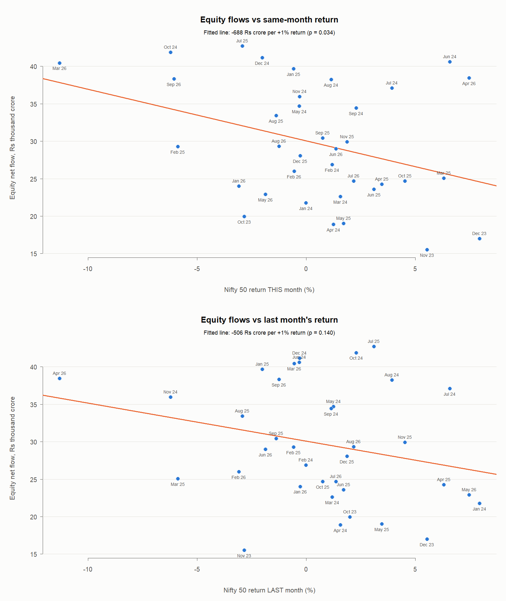
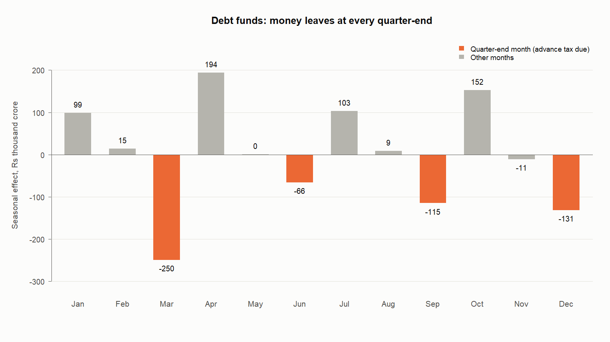

# Mutual Funds Flows Dashboard

An end-to-end analysis of **Indian mutual fund flows**, built using **R**. It studies how investor money moves across fund categories (equity, debt, hybrid, gold ETFs, index funds and others), and whether those flows react to the stock market.

The core is written in **R**: downloading and scraping the data, cleaning it, and the statistical analysis. R then loads the clean data into a **SQLite** database, where the same questions are answered again in **SQL**. The results are visualised in Power BI and Tableau.


## Data

| Source | What | How it is collected |
|---|---|---|
| [AMFI](https://www.amfiindia.com/) monthly reports | Inflows, outflows, net flows and AUM by scheme category | 36 Excel files downloaded in a loop |
| AMFI [mutual-fund page](https://www.amfiindia.com/mutual-fund) | Monthly SIP contributions | HTML table scraped with `xml2` |
| Yahoo Finance (`^NSEI`) | Nifty 50 monthly closing prices | JSON read with `jsonlite` |

- **Period:** October 2023 to September 2026 (36 months).
- **Units:** all amounts are in Rs crore (1 crore = 10 million rupees).
- **About AMFI:** AMFI is the industry body for Indian mutual funds; SEBI is the regulator.

## Research questions and findings

| Question | Method | Finding |
|---|---|---|
| Where is the money going? | Totals, shares, t-tests | **Equity** took in money in **all 36 months** (average Rs 29,700 cr/month) and received **52%** of all net inflows. Hybrid received 20% and ETFs other than gold 12%. |
| Do investors chase returns? | `lm(equity_flow ~ nifty_return + lag)` | **No, the opposite.** A month with a 1 percentage point higher Nifty return comes with about **Rs 733 cr *lower*** equity net flows (p = 0.02). Indian equity investors look more like **"buy the dip"** investors than return chasers. R² = 0.20. The result survives two robustness checks (see below). |
| Flight to safety into gold? | `lm(gold_flow ~ nifty_return)` | **Not supported.** The slope is negative, as the theory predicts, but not significant (p = 0.29). Gold ETF flows show a clear **upward trend** (+Rs 168 cr per month, p = 0.02), which points to gold's own momentum rather than equity falls. |
| Are SIP flows more stable than lump-sum? | Coefficient of variation, regression with a trend term | **Yes.** SIP grows almost like a straight line: +Rs 443 cr per month, R² = 0.96, with no significant reaction to Nifty. After removing the trend, monthly SIP noise is about Rs 1,000 cr, compared with about Rs 9,000 cr for lump-sum inflows. |
| Why are debt flows so volatile? | `decompose()` seasonal factors | Debt flows are not different from zero on average (p = 0.90) but swing by ±Rs 2 lakh crore. **Quarter-end months (Mar, Jun, Sep, Dec) average −Rs 1.4 lakh cr** of seasonal outflow. This matches the timing of corporate advance-tax payments (15 Jun, Sep, Dec, Mar), when companies pull cash out of liquid funds. |





**Robustness of the "buy the dip" result**
- **Autocorrelation.** Equity flows are sticky (lag-1 autocorrelation 0.54), and the residuals of the basic regression are borderline autocorrelated (Ljung-Box p = 0.05), which can make p-values look too good. Adding last month's flow as a control removes the autocorrelation (Ljung-Box p = 0.89), and the same-month Nifty slope stays negative and significant (−Rs 659 cr, p = 0.02).
- **Single months.** Re-running the regression 36 times, leaving one month out each time, the slope is negative every time (−Rs 620 cr to −Rs 902 cr). The p-value ranges from 0.005 to 0.06; it is weakest when March 2026 (Nifty −11.3%) is left out, so that month matters but does not create the result on its own.

**Caveats**
- 36 monthly observations are enough for these tests, but not for strong causal claims.
- Last month's Nifty return is not significant once last month's flow is controlled for (p = 0.43), so the evidence is for a same-month reaction only.
- "Lump-sum" equity inflow is approximated as gross equity inflow minus total SIP contributions.

## Methods (all in R)

1. **Descriptive analysis:** summary statistics, category shares, AUM and SIP growth, correlation matrix, base R plots.
2. **Hypothesis tests:**
   - one- and two-sample **z-tests**, written by hand because base R has no `z.test()`
   - the same tests with `t.test()`, which is the correct choice at n = 36
   - `prop.test()` on the share of positive-flow months
3. **Regression with `lm()`:** trend models, return chasing (same-month and lagged returns), flight to safety, and SIP vs lump-sum. Results are read through `summary()`, and residual diagnostics come from `plot(model)`. Two robustness checks: a lagged-flow control and a leave-one-month-out loop.
4. **OLS by matrix algebra:** the return-chasing regression is computed by hand as `beta = solve(t(X) %*% X) %*% t(X) %*% y`, with standard errors from `sigma² (X'X)⁻¹`. The result matches `lm()` exactly. See [outputs/tables/ols_matrix_vs_lm.csv](outputs/tables/ols_matrix_vs_lm.csv).
5. **Time-series analysis:** monthly `ts()` objects, `decompose()` into trend, seasonal and random parts, `acf()` and the `Box.test()` (Ljung-Box) test for autocorrelation.

The analysis uses only base R plus three small packages: `readxl`, `xml2` and `jsonlite`.

## SQL

[code/04_sql_database.R](code/04_sql_database.R) builds a SQLite database (`data/mutual_funds.sqlite`) from the clean data, using the `DBI` and `RSQLite` packages. It then runs the seven queries in [code/queries.sql](code/queries.sql) and checks that SQL and R give the same totals.

| Query | SQL features | What it shows |
|---|---|---|
| Q1 | `GROUP BY`, window `SUM() OVER ()` | Total net flow and share per category |
| Q2 | `CASE` inside `SUM` | Number of positive-flow months per category |
| Q3 | `CASE`, `strftime` | Quarter-end effect in debt, liquid and equity funds |
| Q4 | `JOIN` | Equity flows in months the Nifty fell vs rose |
| Q5 | `LAG()`, moving-average window | Month-on-month change and 3-month average |
| Q6 | CTE (`WITH`), `RANK() OVER (PARTITION BY)` | Top 3 inflow months per category |
| Q7 | `CASE`, `CAST` | Totals by Indian financial year |

Two results from SQL that back up the R analysis:

- **Q3, quarter-end effect.** Debt funds lose an average of Rs 1.37 lakh crore in quarter-end months and gain Rs 1.43 lakh crore in the month after, so the money comes straight back. Liquid funds alone account for about Rs 80,000 crore of each swing. Equity funds show no such pattern (about Rs 28,000 to 31,000 crore in all three groups).
- **Q4, buy the dip.** Equity funds took in an average of Rs 32,329 crore in the 17 months when the Nifty fell, against Rs 27,390 crore in the 19 months when it rose.

To run the queries by hand, open `data/mutual_funds.sqlite` in [DB Browser for SQLite](https://sqlitebrowser.org/) and paste a query into the "Execute SQL" tab.

## Data cleaning highlights

- AMFI names every file `.xls`, but 21 of the 36 are really `.xlsx`. The download script reads each file's signature bytes and renames it to its real format.
- In **August 2026** AMFI changed the report layout after SEBI re-categorised funds: new sections, and index funds and ETFs split into sub-groups. The cleaning script maps both layouts to the same 8 broad categories, using section sub-totals.
- Downloads go to a temporary file first and are retried up to 3 times, so a dropped connection can never leave a broken file in `data/raw/`. The script stops with a clear message if any of the 36 reports is missing.
- Automatic checks stop the script if anything is off:
  - exactly 36 months
  - the title inside each Excel file matches the month in its file name
  - no missing values
  - inflow − outflow = net flow
  - the 8 categories add up to AMFI's own open-ended total every month, for inflows, outflows, net flows and AUM

## How to run

Open `Mutual-funds-flows-dashboard.Rproj` in RStudio, which sets the working folder, then run the scripts in order:

```r
source("code/01_download_data.R")   # downloads raw files into data/raw/
source("code/02_clean_data.R")      # writes clean CSVs into data/clean/
source("code/03_analysis.R")        # writes figures, tables and full output into outputs/
source("code/04_sql_database.R")    # builds the SQLite database and runs queries.sql
```

Required packages: `install.packages(c("readxl", "xml2", "jsonlite", "DBI", "RSQLite"))`

## Project structure

```
code/
  01_download_data.R     download AMFI reports, scrape SIP table, get Nifty 50 prices
  02_clean_data.R        clean and combine into tidy CSV files
  03_analysis.R          descriptive stats, tests, regressions, matrix OLS, time series
  04_sql_database.R      build the SQLite database, run the SQL queries, cross-check with R
  queries.sql            the seven SQL queries
data/
  raw/                   files exactly as downloaded
  clean/                 category_flows.csv, analysis_dataset.csv, sip_monthly.csv, nifty_monthly.csv
  mutual_funds.sqlite    the SQL database (tables: category_flows, monthly_summary)
outputs/
  analysis_output.txt    full printed results of 03_analysis.R
  figures/               12 charts (PNG), with data points labelled
  tables/                results as CSV, including sql_q1.csv to sql_q7.csv (also used by the dashboards)
dashboards/              Power BI / Tableau guide and DAX measures
```

## Tools
- **R** 4.6.1 with RStudio: extraction, cleaning, analysis
- **SQLite** (through R's `DBI` and `RSQLite`, and DB Browser for SQLite): SQL queries
- **Power BI Desktop** and **Tableau**: dashboards (see [dashboards/](dashboards/))
